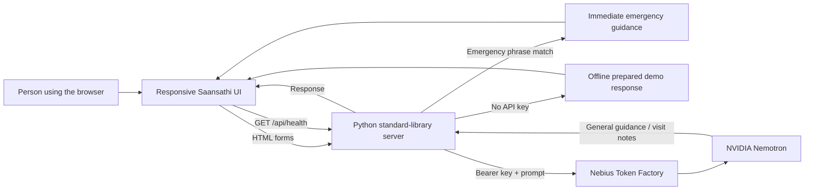

<h1 align="center">Saansathi</h1>

<p align="center">
  <b>A calmer way to prepare for your next respiratory-care conversation.</b>
</p>

<p align="center">
  <a href="docs/ARCHITECTURE.md">Architecture</a> ·
  <a href="docs/DEMO_GUIDE.md">Demo walkthrough</a> ·
  <a href="#project-structure">Project structure</a>
</p>

<p align="center">
  <a href="https://render.com/deploy?repo=https://github.com/AnuragVerma777/saansathi">
    
  </a>
</p>

**Live demo:** [Open Saansathi](https://saansathi-ypc83mz5xbocxdu9xmoedv.streamlit.app/). The demo runs without Nebius billing in offline mode; Nebius-powered answers require an API key and account billing. To host your own Render copy, use [Deploy to Render](https://render.com/deploy?repo=https://github.com/AnuragVerma777/saansathi).

Saansathi is a respiratory-care navigation prototype. It helps people organize symptoms, prepare neutral notes for a clinician, and ask general questions. It is not a medical service and does not screen for TB, diagnose, calculate risk, or replace professional care.

## Features

| Feature | What it does | Boundary |
| --- | --- | --- |
| Guided check-in | Select symptoms, duration, and optional context | Organizes user-provided information; does not assess or score it |
| Visit preparation | Creates a concise clinician-facing summary and questions | Never adds symptoms or diagnostic conclusions |
| Ask Saansathi | Gives general respiratory-care guidance; uses Nemotron when Nebius is connected | Offline demo uses prepared example responses; not a clinician or emergency service |
| English / Bahasa Indonesia | Choose the language for model replies | UI labels are currently in English |
| Urgent-help guidance | Recognizes a small set of emergency phrases and shows immediate guidance | A demo keyword rule; not a validated safety system |
| Private by default | No account or database; submissions are not saved | Text sent for AI assistance goes to the configured Nebius endpoint |
| Responsive dark UI | High-contrast dark theme for desktop and mobile | Requires a modern browser |

## How it works



The server keeps `NEBIUS_API_KEY` out of browser code. The browser does not send requests directly to Nemotron. See the [architecture notes](docs/ARCHITECTURE.md) for request flow and deployment details.

## Technology

| Layer | Technology | Role |
| --- | --- | --- |
| Interface | Python-rendered HTML, CSS | Responsive server-rendered check-in and Q&A; no browser JavaScript |
| Server | Python 3.10+, standard library; Streamlit for Streamlit Cloud | Local HTTP mode and Streamlit Cloud UI, input limits, emergency phrase handling, provider proxy |
| Model API | Nebius Token Factory, OpenAI-compatible chat completions | Serves the configured NVIDIA Nemotron model |
| Hosting | Render Web Service Blueprint | One-click deploy configuration in `render.yaml` |

## Project structure

```text
saansathi/
├── README.md                 # Overview, diagrams, setup, and feature tables
├── app.py                    # Python web app, forms, demo guide, and Nebius proxy
├── requirements.txt          # Streamlit dependency for Streamlit Cloud
├── .env.example              # Local configuration template (no real key)
├── .gitignore                # Excludes .env and generated files
├── render.yaml               # Render service and secret-variable configuration
├── public/
│   └── styles.css            # Dark responsive design system
└── docs/
    ├── ARCHITECTURE.md       # Data flow and API contract
    └── DEMO_GUIDE.md         # Short presenter walkthrough
```

## Run locally

**Requirements:** Python 3.10 or newer. Local HTTP mode uses the standard library; install Streamlit only if you want to run the Streamlit interface locally.

```powershell
python app.py
```

For Streamlit Cloud compatibility, select `app.py` as the app entrypoint. Streamlit is installed from `requirements.txt`. The same file supports both Streamlit Cloud and the local `python app.py` server.

Open [http://localhost:3000](http://localhost:3000). Without an API key, the app runs in offline demo mode with prepared example responses and emergency phrase handling. These examples are not AI-generated. To use Nebius, set `NEBIUS_API_KEY` in `.env`; the key stays server-side. Never commit `.env` or paste the key into chat. Nebius responses require an enabled account and API key.

To force the free offline demo even when a key exists in `.env`, start the server with `SAANSATHI_DEMO_MODE=true` in its environment. For PowerShell: `$env:SAANSATHI_DEMO_MODE='true'; python app.py`.

### Configuration

| Variable | Default | Purpose |
| --- | --- | --- |
| `NEBIUS_API_KEY` | — | Required secret for Nebius Token Factory |
| `NEBIUS_BASE_URL` | `https://api.tokenfactory.nebius.com/v1` | OpenAI-compatible API base URL |
| `NEBIUS_MODEL` | `nvidia/Nemotron-3_5-Lightning` | Model ID; set to a model enabled for your account |
| `PORT` | `3000` | Local or host listening port |

## API routes

| Method | Path | Purpose |
| --- | --- | --- |
| `GET` | `/api/health` | Reports server status, model ID, and whether the key is configured |
| `POST` | `/api/guide` | Accepts a question or symptom notes and returns guidance or visit-prep text |
| `GET` | `/` | Serves the web app |

The Python server offers HTML forms at `/checkin` and `/ask`, plus `GET /api/health`. It limits request size and does not persist request bodies.

## Deploy to Render

1. Click **Deploy to Render** above and sign in to Render.
2. Review the Blueprint. Enter your Nebius key directly into Render's `NEBIUS_API_KEY` secret field.
3. Deploy. Render provides a public `onrender.com` service URL after the build completes.

The free plan may sleep while idle, so the first request after inactivity may take longer. For hosted-demo setup details, see [Render's Blueprint guide](https://render.com/docs/blueprint-spec) and the [Deploy to Render button documentation](https://render.com/docs/deploy-to-render).

## Demo flow

1. Choose a few symptom chips and a duration; add a brief, non-identifying note.
2. Generate the visit-preparation summary and copy it.
3. Ask a suggested question and show the next-step guidance. Mention Nemotron only if the app header reports it connected.
4. Open **See urgent signs** to show the emergency-help guidance.

The video intro, narration, and shot-by-shot presenter script are in [docs/DEMO_GUIDE.md](docs/DEMO_GUIDE.md).

## Safety and privacy

- Saansathi offers general information and visit preparation, not a diagnosis, risk score, or treatment plan.
- Severe breathing trouble, blue lips or face, fainting, and severe chest pain should receive immediate emergency attention. Do not wait for an AI response.
- The emergency phrase check and model prompt are demo safeguards, not validated medical-device controls.
- There are no accounts or database. Page notes live in browser memory and are sent to Nebius only when the user asks for model assistance. Avoid entering names or identifying details.
- For ongoing, worsening, or concerning symptoms, contact a qualified clinician.
