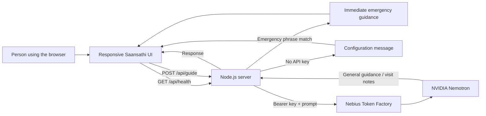

<h1 align="center">Saansathi</h1>

<p align="center">
  <b>A calmer way to prepare for your next respiratory-care conversation.</b>
</p>

<p align="center">
  <a href="docs/ARCHITECTURE.md">Architecture</a> ·
  <a href="docs/DEMO_GUIDE.md">Demo walkthrough</a> ·
  <a href="#project-structure">Project structure</a>
</p>

<p align="center">
  <a href="https://render.com/deploy?repo=https://github.com/AnuragVerma777/saansathi">
    
  </a>
</p>

**Try demo on Render:** [Open the Render setup](https://render.com/deploy?repo=https://github.com/AnuragVerma777/saansathi). This creates a hosted copy in your Render account; a shared public instance has not been deployed yet. Render needs a Nebius API key before AI features can respond.

Saansathi is a respiratory-care navigation prototype. It helps people organize symptoms, prepare neutral notes for a clinician, and ask general questions. It is not a medical service and does not screen for TB, diagnose, calculate risk, or replace professional care.

## Features

| Feature | What it does | Boundary |
| --- | --- | --- |
| Guided check-in | Select symptoms, duration, and optional context | Organizes user-provided information; does not assess or score it |
| Visit preparation | Creates a concise clinician-facing summary and questions | Never adds symptoms or diagnostic conclusions |
| Ask Saansathi | Answers general respiratory-care questions with Nemotron | General education only; not a clinician or emergency service |
| English / Bahasa Indonesia | Choose the language for model replies | UI labels are currently in English |
| Urgent-help guidance | Recognizes a small set of emergency phrases and shows immediate guidance | A demo keyword rule; not a validated safety system |
| Private by default | No account or database; notes remain in page memory | Text sent for AI assistance goes to the configured Nebius endpoint |
| Responsive dark UI | High-contrast dark theme for desktop and mobile | Requires a modern browser with JavaScript enabled |

## How it works



The server keeps `NEBIUS_API_KEY` out of browser code. The browser does not send requests directly to Nemotron. See the [architecture notes](docs/ARCHITECTURE.md) for request flow and deployment details.

## Technology

| Layer | Technology | Role |
| --- | --- | --- |
| Interface | HTML, CSS, browser JavaScript | Responsive check-in, Q&A, copyable visit notes |
| Server | Node.js 20+, built-in HTTP and `fetch` | Static files, input limits, emergency phrase shortcut, provider proxy |
| Model API | Nebius Token Factory, OpenAI-compatible chat completions | Serves the configured NVIDIA Nemotron model |
| Hosting | Render Web Service Blueprint | One-click deploy configuration in `render.yaml` |

## Project structure

```text
saansathi/
├── README.md                 # Overview, diagrams, setup, and feature tables
├── package.json              # Start and development commands
├── .env.example              # Local configuration template (no real key)
├── .gitignore                # Excludes .env and generated files
├── render.yaml               # Render service and secret-variable configuration
├── public/
│   ├── index.html            # Main responsive interface
│   ├── styles.css            # Dark design system and readable type scale
│   └── app.js                # Check-in, Q&A, and browser interactions
├── server/
│   └── server.mjs            # Static server and Nebius API proxy
└── docs/
    ├── ARCHITECTURE.md       # Data flow and API contract
    └── DEMO_GUIDE.md         # Short presenter walkthrough
```

## Run locally

**Requirements:** Node.js 20 or newer. No dependency installation is required.

```powershell
Copy-Item .env.example .env
notepad .env
npm start
```

Set `NEBIUS_API_KEY` in `.env`, save, and open [http://localhost:3000](http://localhost:3000). The key stays on the server. Never commit `.env` or paste the key into chat. If no key is configured, the page loads and the emergency phrase shortcut still works, but model responses are unavailable.

### Configuration

| Variable | Default | Purpose |
| --- | --- | --- |
| `NEBIUS_API_KEY` | — | Required secret for Nebius Token Factory |
| `NEBIUS_BASE_URL` | `https://api.tokenfactory.nebius.com/v1` | OpenAI-compatible API base URL |
| `NEBIUS_MODEL` | `nvidia/Nemotron-3_5-Lightning` | Model ID; set to a model enabled for your account |
| `PORT` | `3000` | Local or host listening port |

## API routes

| Method | Path | Purpose |
| --- | --- | --- |
| `GET` | `/api/health` | Reports server status, model ID, and whether the key is configured |
| `POST` | `/api/guide` | Accepts a question or symptom notes and returns guidance or visit-prep text |
| `GET` | `/` | Serves the web app |

Request fields for `/api/guide`: `message` (question), `details` (optional check-in), and `language` (`English` or `Bahasa Indonesia`). The server limits request size and does not persist request bodies.

## Deploy to Render

1. Click **Deploy to Render** above and sign in to Render.
2. Review the Blueprint. Enter your Nebius key directly into Render's `NEBIUS_API_KEY` secret field.
3. Deploy. Render provides a public `onrender.com` service URL after the build completes.

The free plan may sleep while idle, so the first request after inactivity may take longer. For hosted-demo setup details, see [Render's Blueprint guide](https://render.com/docs/blueprint-spec) and the [Deploy to Render button documentation](https://render.com/docs/deploy-to-render).

## Demo flow

1. Choose a few symptom chips and a duration; add a brief, non-identifying note.
2. Generate the visit-preparation summary and copy it.
3. Ask a suggested question, then switch the reply language to Bahasa Indonesia.
4. Open **See urgent signs** to show the emergency-help guidance.

A concise presenter script is in [docs/DEMO_GUIDE.md](docs/DEMO_GUIDE.md).

## Safety and privacy

- Saansathi offers general information and visit preparation, not a diagnosis, risk score, or treatment plan.
- Severe breathing trouble, blue lips or face, fainting, and severe chest pain should receive immediate emergency attention. Do not wait for an AI response.
- The emergency phrase check and model prompt are demo safeguards, not validated medical-device controls.
- There are no accounts or database. Page notes live in browser memory and are sent to Nebius only when the user asks for model assistance. Avoid entering names or identifying details.
- For ongoing, worsening, or concerning symptoms, contact a qualified clinician.
