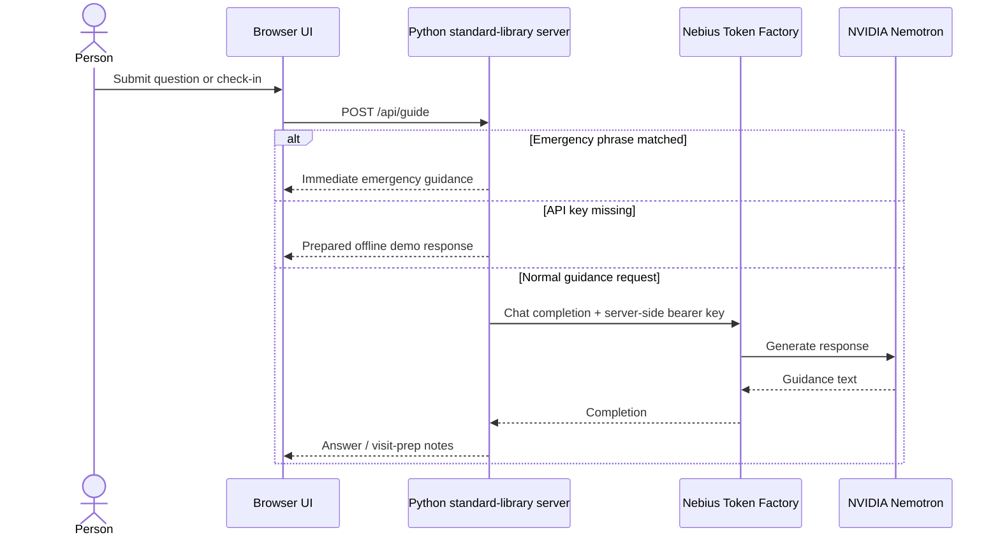

# Architecture

Saansathi is a single Python web service that renders HTML and handles form submissions server-side. It has no database, login, browser-side JavaScript, audio capture, or clinical scoring service.

## Request flow

## Components

| Component | Location | Responsibility |
| --- | --- | --- |
| Web app | `app.py` | Renders pages, handles symptom/Q&A forms, loads local `.env`, checks emergencies, proxies optional model calls |
| Styling | `public/styles.css` | Dark responsive UI and readable type scale |
| Provider configuration | `.env` locally; host environment in deployment | Supplies API base URL, key, model, and port |
| Render service | `render.yaml` | Describes the Node web service and prompts for `NEBIUS_API_KEY` as a secret |

## API contract

### `GET /api/health`

Returns `{ ok, provider, model, configured }`. It never returns the API key.

### `POST /api/guide`

Accepts JSON with:

| Field | Type | Required | Notes |
| --- | --- | --- | --- |
| `message` | string | One of `message` or `details` | Question or generation instruction; truncated to 3,000 characters |
| `details` | string | One of `message` or `details` | Optional non-identifying symptom notes; truncated to 3,000 characters |
| `language` | string | No | `English` or `Bahasa Indonesia`; unsupported values default to English |

The server rejects empty requests and bodies over 16 KB. Emergency phrases return deterministic urgent-care wording before any provider call. Without a key, non-emergency requests use prepared offline demo responses. When configured, requests are forwarded to Nebius `/chat/completions` using a server-side bearer key and a 45-second timeout. Request bodies are not written to application storage.

## Boundaries

- No diagnosis, risk estimates, medication instructions, or automated care eligibility decisions.
- The urgent phrase matcher is intentionally small and cannot detect every emergency; users should seek emergency care when needed.
- This prototype has not been clinically validated. It is for demonstration and general education only.
