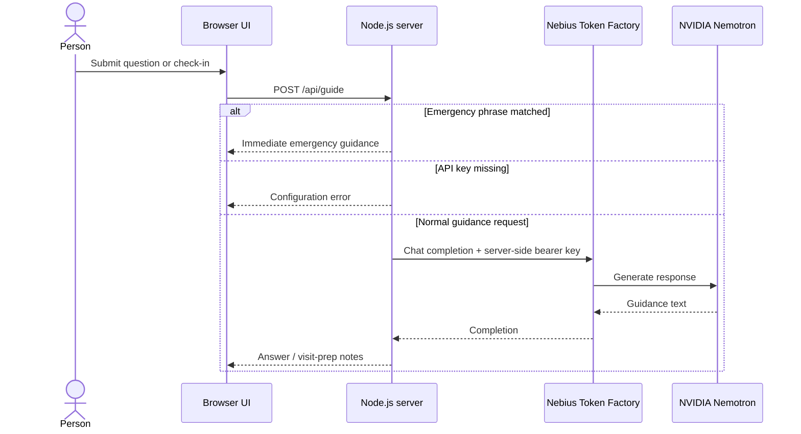

# Architecture

Saansathi is a single Node.js web service with a static browser client and a server-side model proxy. It has no database, login, audio capture, or clinical scoring service.

## Request flow

## Components

| Component | Location | Responsibility |
| --- | --- | --- |
| Browser UI | `public/index.html`, `public/app.js`, `public/styles.css` | Guided symptom selection, duration, Q&A, copyable notes, language selector, urgent-help dialog |
| HTTP server | `server/server.mjs` | Loads local `.env`, serves `public/`, validates request shape/size, checks emergency phrases, proxies model calls |
| Provider configuration | `.env` locally; host environment in deployment | Supplies API base URL, key, model, and port |
| Render service | `render.yaml` | Describes the Node web service and prompts for `NEBIUS_API_KEY` as a secret |

## API contract

### `GET /api/health`

Returns `{ ok, provider, model, configured }`. It never returns the API key.

### `POST /api/guide`

Accepts JSON with:

| Field | Type | Required | Notes |
| --- | --- | --- | --- |
| `message` | string | One of `message` or `details` | Question or generation instruction; truncated to 3,000 characters |
| `details` | string | One of `message` or `details` | Optional non-identifying symptom notes; truncated to 3,000 characters |
| `language` | string | No | `English` or `Bahasa Indonesia`; unsupported values default to English |

The server rejects malformed JSON, empty requests, and bodies over 16 KB. Emergency phrases return deterministic urgent-care wording before any provider call. Non-emergency requests are forwarded to the configured Nebius `/chat/completions` endpoint using a server-side bearer key and a 45-second timeout. Request bodies are not written to application storage.

## Boundaries

- No diagnosis, risk estimates, medication instructions, or automated care eligibility decisions.
- The urgent phrase matcher is intentionally small and cannot detect every emergency; users should seek emergency care when needed.
- This prototype has not been clinically validated. It is for demonstration and general education only.
